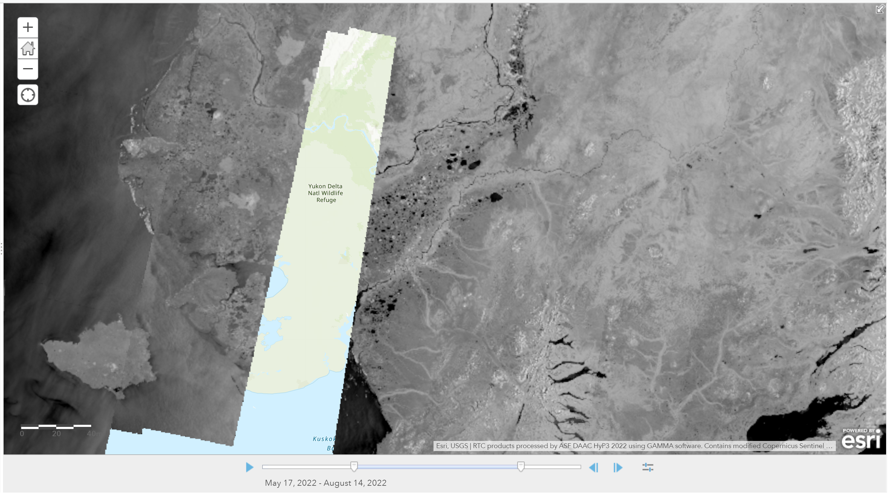

# Sentinel-1 Mission

The Sentinel-1 satellite constellation is part of the Copernicus Earth Observation program, coordinated by the European 
Space Agency (ESA) on behalf of the European Commission (EC). Sentinel-1 satellites carry C-band Synthetic Aperture 
Radar (SAR) instruments for global, around-the-clock imagery acquisition, even through cloud cover. 

The mission was designed to support surface deformation applications, and the stable orbits and consistent 
acquisition plans of the Sentinel-1 satellites make it easy to generate high-quality Interferometric SAR (InSAR) 
products. These products can measure deformation to the centimeter scale, though the 5.6-cm wavelength 
of the C-band SAR sensor limits the viability of InSAR in densely vegetated areas. 

The relatively short interval between acquisitions makes this SAR dataset a very useful tool for monitoring rapid or 
sudden landscape changes. In addition, SAR can image the earth's surface through cloud or smoke cover and does not 
require sunlight, so valid imagery can be collected on every pass. This is particularly useful for monitoring 
conditions during natural disasters such as hurricanes or wildfires, or in areas that are prone to frequent cloud cover.

More information about the mission is available from the 
[European Space Agency Sentinel-1 Mission website](https://sentiwiki.copernicus.eu/web/s1-mission "Sentinel-1 Mission" ){target=_blank}.

## The Sentinel-1 Constellation

The Sentinel-1 mission was designed to be a two-satellite constellation, though there have been periods when 
only one satellite has been available for image acquisition.

- Sentinel-1A was launched April 3, 2014, and acquired imagery until it was [decommissioned on June 29, 2026](https://defence-industry-space.ec.europa.eu/sentinel-1a-concludes-its-mission-leaving-lasting-legacy-copernicus-2026-06-30_en "https://defence-industry-space.ec.europa.eu/sentinel-1a-concludes-its-mission-leaving-lasting-legacy-copernicus-2026-06-30_en" ){target=_blank}.
- Sentinel-1B  was launched April 25, 2016, but [its mission ended on December 23, 2021](https://www.esa.int/Applications/Observing_the_Earth/Copernicus/Sentinel-1/Mission_ends_for_Copernicus_Sentinel-1B_satellite "https://www.esa.int/Applications/Observing_the_Earth/Copernicus/Sentinel-1/Mission_ends_for_Copernicus_Sentinel-1B_satellite" ){target=_blank}.
- Sentinel-1C was launched December 5, 2024, replacing Sentinel-1B in the constellation, and has been [acquiring imagery regularly since March 26, 2025](https://dataspace.copernicus.eu/news/2025-3-25-sentinel-1c-user-data-opening-26th-march "https://dataspace.copernicus.eu/news/2025-3-25-sentinel-1c-user-data-opening-26th-march" ){target=_blank}. In June 2026, [Sentinel-1C was maneuvered into position one day behind the Sentinel-1A orbit](https://dataspace.copernicus.eu/news/2026-5-28-sentinel-1-orbital-reconfiguration-dates "https://dataspace.copernicus.eu/news/2026-5-28-sentinel-1-orbital-reconfiguration-dates" ){target=_blank}. It did not collect data during the transition period, which took place from June 9 to 23, 2026.
- Sentinel-1D was launched November 4, 2025, and 
  [calibrated data is available for acquisitions starting April 17, 2026](https://sentinels.copernicus.eu/-/sentinel-1d-user-data-opening-from-17-april-2026 "https://sentinels.copernicus.eu/-/sentinel-1d-user-data-opening-from-17-april-2026" ){target=_blank}. 
  Sentinel-1D is positioned one day behind the original Sentinel-1C (former Sentinel-1B) orbit.

Each Sentinel-1 satellite has a 12-day repeat cycle, and they all use the same orbit pattern. When there are two active 
sensors in the constellation, their orbits are offset to allow repeat passes every 6 days. In this 
scenario, most global landmasses are imaged every 12 days. However, some areas of particular interest to the EC, 
including Europe and areas undergoing rapid changes due to uplift or subsidence activity, are imaged every 6 days. 

Note that the acquisition plan for the second-generation constellation (Sentinel-1C and 1D) is 
[shifted by one day](https://dataspace.copernicus.eu/news/2026-4-2-sentinel-1d-user-data-opening-and-future-plans "https://dataspace.copernicus.eu/news/2026-4-2-sentinel-1d-user-data-opening-and-future-plans" ){target=_blank} 
from the original Sentinel-1A and 1B acquisition plan.

Refer to the [Sentinel-1 Acquisition Plans](https://sentinels.copernicus.eu/copernicus/sentinel-1/acquisition-plans "https://sentinels.copernicus.eu/copernicus/sentinel-1/acquisition-plans" ){target=_blank} 
page to access the acquisition plans that have been used to meet the [mission observation scenario](https://sentiwiki.copernicus.eu/web/s1-mission#Observation-and-Production-Scenarios "https://sentiwiki.copernicus.eu/web/s1-mission#Observation-and-Production-Scenarios" ){target=_blank} 
under different constellation configurations.

## Transition from Sentinel-1B to Sentinel-1C

Sentinel-1B stopped acquiring data on December 23, 2021. An anomaly related to the power supply could not be repaired, 
and the [satellite was decommissioned](https://www.esa.int/Applications/Observing_the_Earth/Copernicus/Sentinel-1/Mission_ends_for_Copernicus_Sentinel-1B_satellite "Mission Ends for Copernicus Sentinel-1B Satellite" ){target=_blank}.

The loss of Sentinel-1B resulted in a significant reduction in the spatial and temporal coverage of the Sentinel-1 
mission. Refer to 
[this article by Iain Woodhouse](https://www.earthblox.io/blog/the-impact-of-the-sentinel-1b-failure-and-looking-forward-to-sentinel-1c "The impact of the Sentinel-1B failure and looking forward to Sentinel-1C" ){target=_blank} 
for an illustration of the global impact of the Sentinel-1B failure. The image below illustrates a gap in the 
acquisitions over Alaska. This area of the Yukon-Kuskokwim Delta did not have a Sentinel-1 acquisition during 
the summer of 2022 until August 15.

The gaps in coverage were particularly noticeable the first few months after Sentinel-1B lost power, but some areas 
continued to have little or no coverage from December 2021 until April 2025, when Sentinel-1C began acquiring data 
regularly. Keep this in mind as you search for Sentinel-1 data in your area of interest. If there are 
fewer results than you would expect, you can 
[download acquisition plans for the mission from ESA](https://sentinels.copernicus.eu/copernicus/sentinel-1/acquisition-plans "Sentinel-1 Acquisition Plans" ){target=_blank} to view the acquisition plan for your area and time period of interest. 
